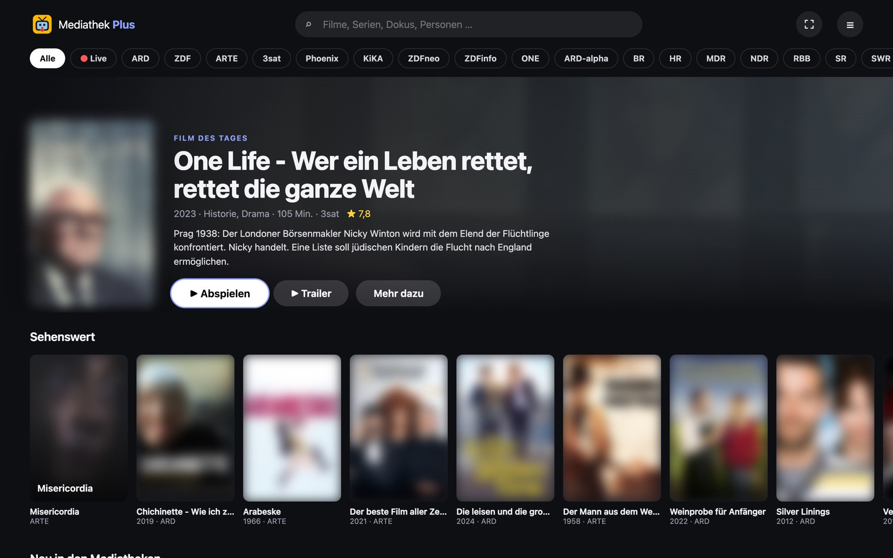
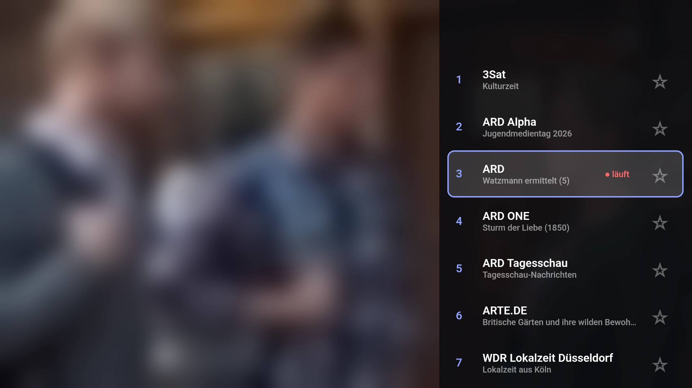
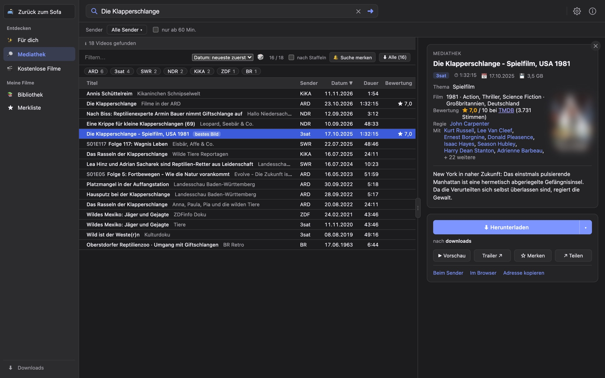
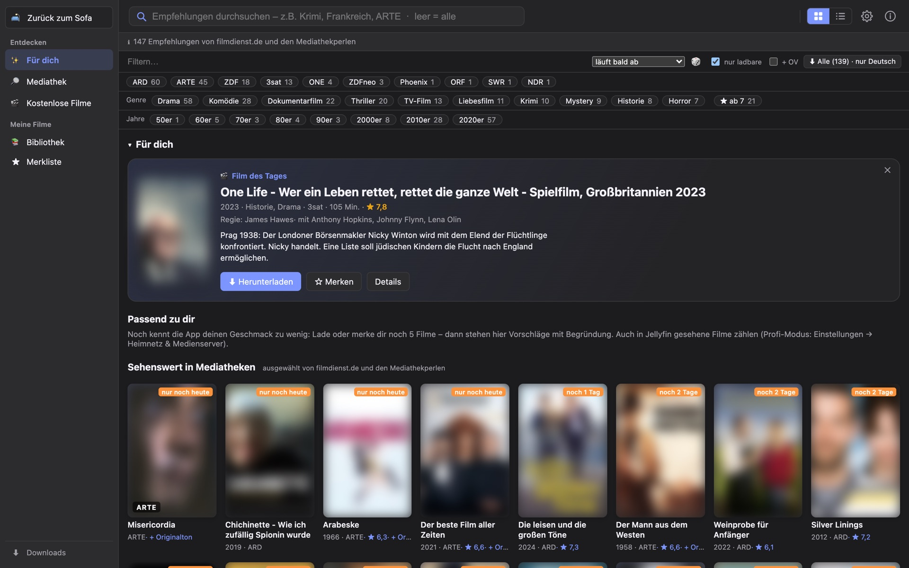

# Mediathek Plus

**Entdecken. Laden. Teilen.** Filme, Serien und Live-TV von ARD, ZDF, ARTE, 3sat … – finden, schauen und laden, bevor sie verschwinden. Für Mac, Windows, Linux, im Browser und auf dem Fernseher.

**[⬇ Neueste Version herunterladen](../../releases/latest)** · kostenlos · ohne Konto · ohne Werbung

<table>
  <tr>
    <td align="center" width="25%"> <b>🛋 Sofa</b> entdecken und schauen</td>
    <td align="center" width="25%"> <b>📺 Fernseher</b> Live-TV mit Senderliste</td>
    <td align="center" width="25%"> <b>Standard</b> suchen und laden</td>
    <td align="center" width="25%"> <b>Profi</b> für Sammler</td>
  </tr>
</table>

Zum Vergrößern anklicken. Film- und Sendebilder für die Screenshots weichgezeichnet – in der App sind sie scharf.

## Was die App kann

| Bereich | Was die App kann |
|---|---|
| 📺&nbsp;**Live-TV** | Alle öffentlich-rechtlichen Sender live, zappen wie am Fernseher: ↑/↓, Senderliste, Lieblingssender und „Jetzt läuft“ – per Fernbedienung, Mausrad oder Wischen. Startet sofort, schaltet flott um |
| 🛋&nbsp;**Sofa** | Einfach schauen: Filme, Serien, Dokus und Live-TV aller Sender direkt abspielen – mit Weiterschauen, nächster Folge, Originalton und Untertiteln, „Für später“ speichern und ganz mit Pfeiltasten bedienbar. Auch ohne Installation [im Browser](https://7hdmm9pp2w-code.github.io/Mediathek-Plus/sofa/) |
| ✨&nbsp;**Für dich** | Jeden Tag ein Film des Tages und Vorschläge nach deinem Geschmack – mit Begründung („Regie wie bei …“), berechnet auf deinem Rechner; lernt auf Wunsch aus dem, was du in Jellyfin gesehen hast |
| 🔎&nbsp;**Suchen** | Alle öffentlich-rechtlichen Mediatheken auf einmal – mit Plakat, Bewertung, Genre, Regie und Besetzung |
| ★&nbsp;**Merkliste** | Filme, Serien und ganze Suchen verfolgen. Taucht etwas auf, meldet sich die App und lädt es auf Wunsch selbst |
| ⬇&nbsp;**Laden** | Deutsch und Original in einer Datei, Untertitel als Spur, fertig benannt für Plex, Jellyfin und Kodi – Filme, Serien und Dokus auf Wunsch in eigene Ordner; Senderlogo auf Wunsch entfernt |
| 📚&nbsp;**Bibliothek** | Alles Geladene an einem Ort – abspielen, im Ordner zeigen, weiterempfehlen. Mit Jellyfin oder Emby verbunden: auch alles von dort, mit „▶ In Jellyfin abspielen“ |
| 📤&nbsp;**Teilen** | Filmtipps als Liste mit einem einzigen Link – wer die App hat, übernimmt alle mit einem Klick |
| 🗄&nbsp;**NAS** | Läuft auch als Docker-Container auf Synology & Co.; die Desktop-App schickt Downloads dorthin, das NAS lädt rund um die Uhr, Einstellungen gelten auf beiden gleich – einrichten mit dem [yml-Baukasten](https://7hdmm9pp2w-code.github.io/Mediathek-Plus/nas/), [Anleitung](NAS.md) |

## Neu in 3.5

- **Live-TV wie am Fernseher:** „● Live“ startet sofort mit dem letzten Sender. Zappen mit ↑/↓, Senderleiste am Rand, Senderliste, Ziffern, Lieblingssender ganz vorn und kurz eingeblendet, was gerade läuft. Am Rechner mit dem Mausrad, auf Handy und Tablet mit Wischen. Gesperrte Sender (z. B. ORF außerhalb Österreichs) blendet die App von selbst aus.
- **Vorschau: App für Fire TV und Android TV** – Live-TV und Sofa direkt auf dem Fernseher, bedient mit der Fernbedienung (siehe [Installation](#auf-dem-fernseher)).
- **Komfort beim Schauen:** Einschlaf-Timer, Untertitel auch live, Sperrbildschirm und Medientasten, Bild im Bild, Vollbild, „Mit Live-TV starten“.
- **Beste Fassung auf einen Blick:** Läuft ein Film bei mehreren Sendern, zeigt die App, wo das Bild deutlich besser ist.
- **Originalton nachrüsten:** Für schon geladene Filme nur die Original-Tonspur nachladen.
- **Sicherer:** Prüfung des gesamten Codes – vor allem der NAS ist jetzt besser gegen Passwort-Durchprobieren geschützt. *NAS mit dem Beispielpasswort „bitte-ändern“? Bitte in der docker-compose.yml ändern.*

Alle Änderungen: [Releases](../../releases)

## Installation

| System | Datei |
|---|---|
| Mac | `…-macOS.dmg` – oder `brew tap 7hdmm9pp2w-code/tap && brew trust 7hdmm9pp2w-code/tap && brew install --cask mediathek-extractor` |
| Windows | `…-Windows-Installer.exe` (ARM: `…-ARM-Installer.exe`), ohne Installation: `…-portabel.zip` |
| Linux | `…-x86_64.AppImage` oder `…-Linux-Debian-Ubuntu.deb` |
| Fire TV, Android TV | `MediathekPlus-TV.apk` (Vorschau) – siehe unten |

Die Installer sind nicht signiert – was beim ersten Start zu tun ist, steht beim [Download](../../releases/latest). Danach aktualisiert sich die App von selbst.

### Auf dem Fernseher

**Fire TV** (Stick, Cube) – einmalig, etwa 5 Minuten:

1. **App „Downloader“ installieren:** Auf der Startseite die Suche (Lupe) öffnen, „Downloader“ eingeben und die App vom Herausgeber **AFTVnews** wählen → Herunterladen. Achtung: Es gibt Nachahmer mit ähnlichem Namen (z. B. „Downloader for Fire, Browser …“) – nur die von AFTVnews nehmen.
2. **Entwickleroptionen freischalten:** Einstellungen → Mein Fire TV → Info → siebenmal auf den Gerätenamen drücken, bis „Sie sind jetzt Entwickler“ erscheint.
3. **Downloader erlauben:** Einstellungen → Mein Fire TV → Entwickleroptionen → „Apps unbekannter Herkunft installieren“ → bei **Downloader** auf „An“.
4. **Mediathek Plus laden:** Downloader öffnen, ins Adressfeld den Code **`2980288`** eingeben → Los → „Installieren“. Der Code führt zur Datei unter `7hdmm9pp2w-code.github.io/Mediathek-Plus/tv.apk` – diese Adresse geht auch direkt. Danach kann die APK-Datei gelöscht werden; Mediathek Plus steht unter „Apps“.

Tipp: Statt mit der Fernbedienung zu tippen, geht es schneller mit der Fire-TV-App auf dem Handy – sie dient als Tastatur.

**Android TV / Google TV:** „Downloader“ (ebenfalls von **AFTVnews**) aus dem Google Play Store installieren, in den Einstellungen unter Apps → Sicherheit & Einschränkungen → „Unbekannte Quellen“ für Downloader erlauben (je nach Gerät etwas anders benannt), dann wie Schritt 4 (Code `2980288`). Oder per `adb install`.

Bedienung: ↑/↓ zappt (bzw. P+/P−), OK öffnet die Senderliste, ≡ merkt den Sender als Favorit, Zurück schließt bzw. beendet. Neue Funktionen kommen automatisch, ohne neue Installation. Ohne App geht es auch im Browser des Fernsehers: [Sofa im Browser](https://7hdmm9pp2w-code.github.io/Mediathek-Plus/sofa/).

## Fehler oder Idee?

Erst nachschlagen? Die [Hilfe](https://7hdmm9pp2w-code.github.io/Mediathek-Plus/hilfe/) erklärt die häufigsten Fragen – von „Download schlägt fehl“ bis „Nicht mehr verfügbar“.

[Issues → New issue](../../issues/new/choose): **Fehler melden** oder **Idee vorschlagen** (kostenloses GitHub-Konto nötig, Meldungen sind öffentlich). Oder direkt in der App: Über → Problem melden…

## Datenschutz

Kein Server, kein Konto, keine Analyse. Merkliste, Verlauf, Vorschläge und Einstellungen bleiben auf deinem Rechner (bzw. deinem NAS). Für Suche, Filminfos und Downloads fragt die App direkt bei den unten genannten Diensten und den Sendern an; diese sehen dabei deine IP-Adresse und den Suchbegriff bzw. Filmtitel.

Bitte nur für Inhalte nutzen, die du privat speichern darfst. Kopiergeschützte Inhalte lädt die App nicht. Kein Angebot von ARD, ZDF oder anderen Sendern.

## Danke

Mediathek Plus baut auf freier Software und offenen Daten auf:
[yt-dlp](https://github.com/yt-dlp/yt-dlp) und [FFmpeg](https://ffmpeg.org) (nicht mitgeliefert, die App nutzt vorhandene oder lädt die offiziellen Versionen) ·
[MediathekViewWeb](https://mediathekviewweb.de) / [MediathekView](https://mediathekview.de) ([unterstützen](https://mediathekview.de/spenden/)) ·
[kinogrid.com](https://kinogrid.com) · Filmtipps von [filmdienst.de](https://www.filmdienst.de) und den [Mediathekperlen](https://nexxtpress.de/author/mediathekperlen/) (mit freundlicher Genehmigung) ·
[TMDB](https://www.themoviedb.org) · [Wikidata](https://www.wikidata.org) (CC0) und [Wikipedia](https://de.wikipedia.org) (CC BY-SA) ·
[Tauri](https://tauri.app) (MIT/Apache-2.0) · [hls.js](https://github.com/video-dev/hls.js) (Apache-2.0) · [qrcode-generator](https://github.com/kazuhikoarase/qrcode-generator) (MIT).
Alle sind unabhängig und nicht für diese App verantwortlich.
*This product uses the TMDB API but is not endorsed or certified by TMDB.*

Ein besonderer Dank geht an Haiko und Marko fürs ausdauernde Testen und für viele Anregungen, ebenso an Johannes, Jan und Philipp – und an alle anderen, die getestet und Ideen beigesteuert haben.

Dieses Repository enthält nur die Installer; der Quellcode ist nicht öffentlich.
